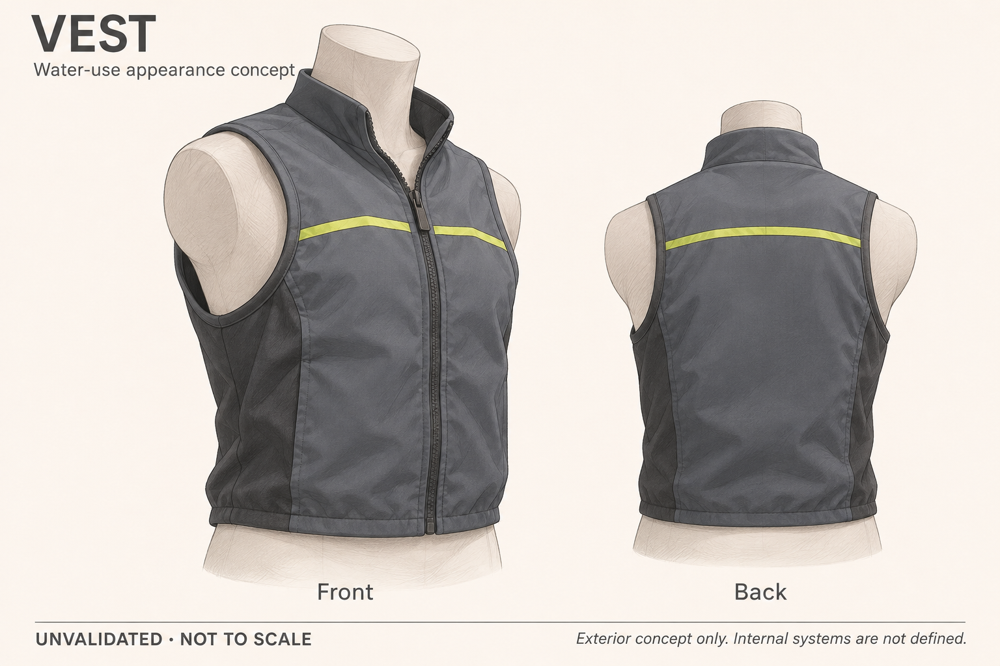

# Adult water-use appearance concept

[Home](../README.md) · [Visual overview](overview.md) · [Priority: child water-approach warning](child-water-proximity-use-case.md)

Version 0.1 — November 8, 2026. AI-generated exterior illustration, not CAD or a fabricated prototype. **Unvalidated and not to scale.**

This preserves the first visual exploration of the earlier adult water-use idea. It provides a silhouette and worn-appearance reference for discussion. The project now prioritizes child water-approach warning; this illustration is not a child garment, an approved flotation device, or a design for the child-warning system.

The depicted collar, closure, seams, accent, and textile appearance are illustrative choices. They do not specify chamber geometry, materials, buoyancy, deployment clearance, inflation, sensor placement, or an alert mechanism. No dimensions, structural calculations, manufacturable pattern, or fit validation have been established. The [adult preparation companion](prototype.md) still uses unmodified reference equipment; this illustration does not change that protocol.

A later CAD model could help explore a defined form, but fabrication-ready work needs agreed users and sizing, requirements, material and component choices, interfaces, and engineering review. For the current highest priority, define child-warning requirements before selecting or drawing child-worn hardware.

## Provenance and reuse

Generated with built-in image generation on November 8, 2026, using no reference images. The [full generation prompt](assets/water-appearance-concept-v1.prompt.txt) is retained with the asset. The preview was visually checked for its two views, readable concept labels, and absence of performance claims. It is not a photograph or evidence of a manufactured product.

See the [license notice](../LICENSING.md) for the image and prompt scope. The illustration has no manufacturer affiliation or endorsement.
