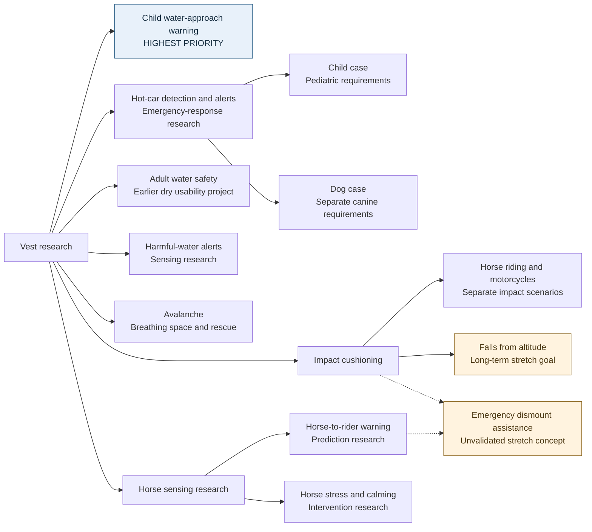
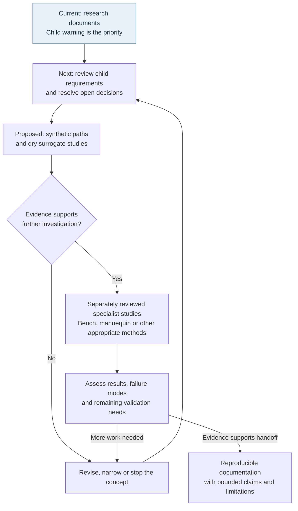

# Visual overview

[Home](../README.md) · [Use-case catalog](use-cases.md) · [Decisions](decisions.md)

November 8, 2026. These diagrams organize research, not the components of a tested product. Text descriptions are included for readers who cannot view Mermaid diagrams.

## Research areas

The highest priority is [child water-approach warning](child-water-proximity-use-case.md): investigate a timely caregiver alert before a young child reaches a water hazard. Its requirements and feasibility work take precedence. The earlier adult [water preparation companion](prototype.md) and proposed dry study remain secondary. Other branches are [avalanche research](avalanche-use-case.md), [impact protection](fall-impact-use-case.md), and [horse-to-vest warning](horse-warning-use-case.md). Falls from altitude remain an explicit long-term goal. The dashed connections indicate that emergency dismount assistance depends on both warning/response research and impact research; they do not imply that a warning makes jumping safe.

The catalog also retains [harmful-water sensing](water-quality-use-case.md) and other rapid falls for later definition. Water-quality warnings are separate from child approach warnings; no wearable contaminant detector is established. None of these branches establishes a universal vest, common trigger, or shared safety certification.

The [child hot-car](child-hot-car-use-case.md) and [dog hot-car](dog-hot-car-use-case.md) branches investigate possible unattended occupancy, heat risk, alerts, and supported emergency escalation. Their physiological and wearability requirements are separate. The [horse calming](horse-calming-use-case.md) branch investigates intervention on the horse, distinct from warning the rider. No automatic dispatch service or effective calming device exists in this project; prevention of spooks or bucking is an unvalidated goal.

The separate [adult appearance concept](appearance-concept.md) explores an exterior silhouette. It does not specify the child-warning wearable or any validated hardware.

## Proposed path from idea to evidence

Research documents, the earlier adult paper mock-up, a new [child-warning review package](child-warning-requirements.md) with [caregiver paper screens](child-caregiver-alert-mockup.md), draft protocols, and an adult appearance illustration exist today. The next step is specialist review of the child requirements and open parameters; synthetic-path and dry-surrogate work remain proposed. No children or water exposure are included in that initial feasibility proposal. Progress depends on evidence and may lead to revision or abandonment. This diagram does not authorize experiments, prescribe one validation route for every use case, or imply certification.

Early research documents can be shared for review before later stages are complete. Public sharing and a reuse license do not establish that the device ideas work. See [next steps](next-steps.md) and [license scope](../LICENSING.md).
