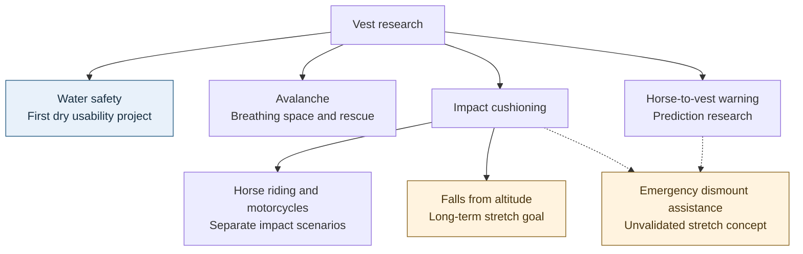
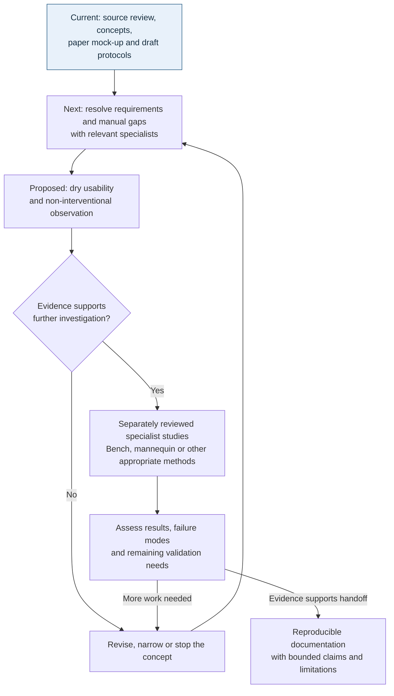

# Visual overview

[Home](../README.md) · [Use-case catalog](use-cases.md) · [Decisions](decisions.md)

November 8, 2026. These diagrams organize research, not the components of a tested product. Text descriptions are included for readers who cannot view Mermaid diagrams.

## Research areas

The first defined project is the [water preparation companion](prototype.md) and its proposed dry usability study. Other branches are [avalanche research](avalanche-use-case.md), [impact protection](fall-impact-use-case.md), and [horse-to-vest warning](horse-warning-use-case.md). Falls from altitude remain an explicit long-term goal. The dashed connections indicate that emergency dismount assistance depends on both warning/response research and impact research; they do not imply that a warning makes jumping safe.

The catalog also retains other rapid falls for later definition. None of these branches establishes a universal vest, common trigger, or shared safety certification.

## Proposed path from idea to evidence

Only the documentation stage exists today. The next step is resolving requirements and source gaps; dry usability and any later specialist work remain proposed. Progress depends on evidence and may lead to revision or abandonment. This diagram does not authorize experiments, prescribe one validation route for every use case, or imply certification.

Early research documents can be shared for review before later stages are complete. Public sharing and a reuse license do not establish that the device ideas work. See [next steps](next-steps.md) and [license scope](../LICENSING.md).
